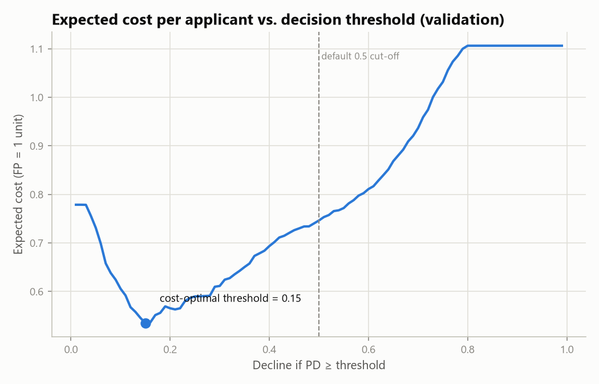
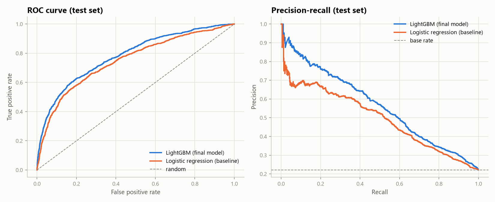
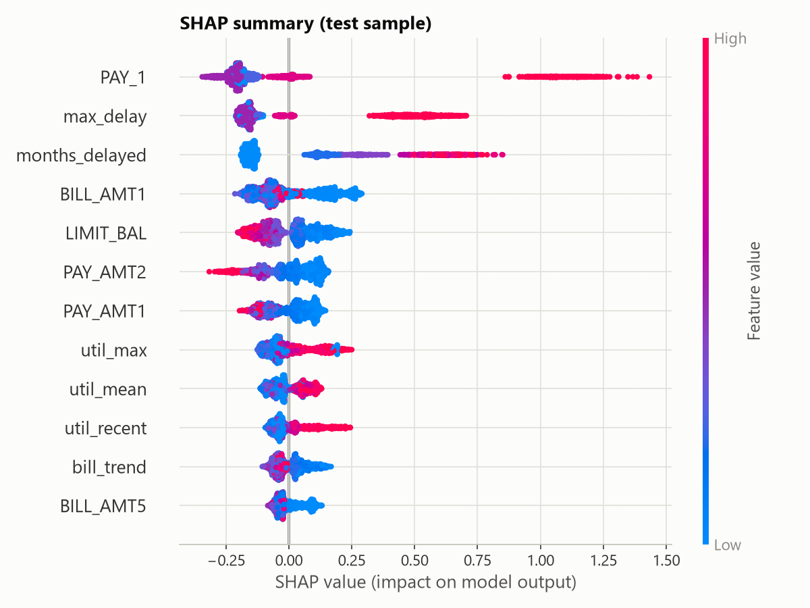
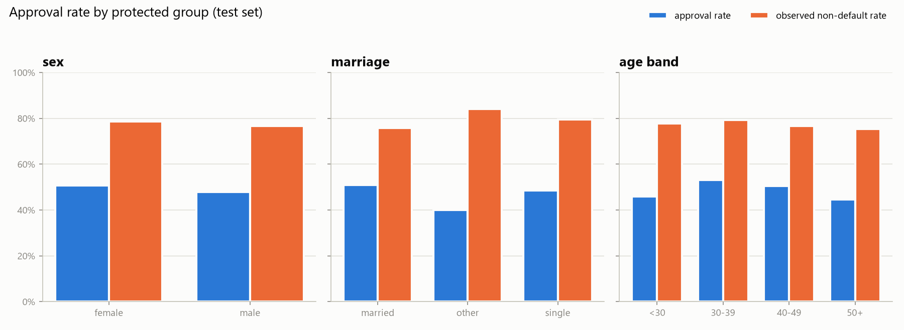

# Credit Default Risk — End-to-End MLOps Pipeline

[](https://github.com/mihribansoykan/credit-risk-mlops/actions/workflows/ci.yml)


> 🇹🇷 **Türkçe özet:** Bu proje, kredi kartı müşterilerinin bir sonraki ay temerrüde düşme olasılığını (PD) tahmin eden, üretime hazır bir makine öğrenmesi hattıdır. Veri şema ile doğrulanır. LightGBM modeli Optuna ile ayarlanır, kalibrasyonu doğrulama setinde test edilir ve **karar eşiği iş maliyetine göre** seçilir. Sonuç olarak test setinde "herkesi onayla" politikasına göre beklenen zarar **%49** azalır. Model SHAP ile açıklanır, korunan gruplar için adillik denetiminden geçer ve PSI ile veri kayması izlenir. Model, Docker'a paketlenmiş bir **FastAPI** servisiyle sunulur. Testler ve Docker build her push'ta GitHub Actions'ta otomatik olarak çalışır.

---

## The problem

A card issuer must decide which customers are likely to **default next month**. Two kinds of mistake cost different amounts:

| Mistake | Business consequence | Assumed cost |
|---|---|---|
| Approving a customer who then defaults (false negative) | credit loss | **5** |
| Declining a customer who would have paid (false positive) | lost margin | **1** |

So the goal is not maximum accuracy. It is the **lowest expected cost per applicant**, using probabilities that can be trusted and decisions that can be explained.

## Results (held-out test set, 6,000 customers)

| Model | ROC-AUC | Gini | KS | PR-AUC | Brier ↓ | Log-loss ↓ |
|---|---|---|---|---|---|---|
| Logistic regression (baseline) | 0.749 | 0.499 | 0.386 | 0.497 | 0.143 | 0.452 |
| **LightGBM (final)** | **0.782** | **0.563** | **0.428** | **0.563** | **0.135** | **0.428** |

| Decision policy | Expected cost / applicant | Approval rate | Default rate among approved | Defaulters caught |
|---|---|---|---|---|
| Approve everyone | 1.106 | 100 % | 22.1 % | 0 % |
| Decline if PD ≥ 0.50 (naive) | 0.741 | 87.8 % | 15.9 % | 36.7 % |
| **Decline if PD ≥ 0.15 (cost-optimal)** | **0.559** | 49.5 % | **9.3 %** | **79.3 %** |

**The cost-optimal threshold cuts expected loss by 49 % compared with approving everyone and by 25 % compared with the default 0.5 cut-off.** The threshold is chosen on the validation set and applied to the test set only once.

<p align="center">
  
  
</p>

## Approach

```mermaid
flowchart LR
    A[UCI raw CSV] --> B[clean + pandera<br/>schema validation]
    B --> C[stratified split<br/>train / valid / test]
    C --> D[feature engineering<br/>utilisation, repayment ratios,<br/>delinquency history]
    D --> E[LightGBM<br/>Optuna 40 trials, 5-fold CV]
    E --> F[calibration choice<br/>none / Platt / isotonic<br/>by CV log-loss on valid]
    F --> G[cost-optimal threshold<br/>on valid]
    G --> H[final evaluation on test<br/>+ SHAP + fairness + PSI]
    H --> I[(model.joblib<br/>metrics.json<br/>MLflow run)]
    I --> J[FastAPI service<br/>Docker]
```



| Step | What & why |
|---|---|
| **Data contract** | A [pandera schema](src/credit_risk/schema.py) rejects impossible values, such as an unknown repayment code. Undocumented category codes are merged into "other" and the change is documented. |
| **Features** | One [`build_features`](src/credit_risk/features.py) function is shared by training and the API, so there is **no training/serving skew**. It adds credit utilisation, repayment-to-bill ratios and delinquency history (months late, worst delay, trend). |
| **Protected attributes** | Sex, marital status and age are **not model inputs**. They are kept aside only to **audit** outcomes. |
| **Tuning** | Optuna TPE search, 40 trials, 5-fold stratified CV ROC-AUC = 0.788. |
| **Calibration** | Tested, not assumed. No calibration, Platt and isotonic were compared on the validation set by cross-validated log-loss. LightGBM was already well calibrated, so *none* was selected. Isotonic would have over-fitted (0.439 vs 0.430). |
| **Decision** | The threshold that minimises expected cost on validation (`configs/train.yaml` holds the cost assumptions). |
| **Explainability** | SHAP values come natively from LightGBM (`pred_contrib`). The API returns the **top 3 risk factors** for every applicant, similar to adverse-action reason codes. |
| **Tracking** | Every run logs parameters, metrics, figures and the model to **MLflow** (`sqlite:///mlflow.db`). |

## Explainability

Recent repayment status dominates: a customer already two months late defaults ~70 % of the time. Higher repayments and higher credit limits reduce risk.

<p align="center"></p>

## Fairness audit

| Attribute | Disparate impact ratio (min/max approval) | Note |
|---|---|---|
| Sex | 0.94 | approval gap in line with observed default rates |
| Age band | 0.84 | under-30s and over-50s have higher false-decline rates (credit limit acts as a proxy) |
| Marital status | **0.79** ⚠️ | below the four-fifths rule for the small *other* group (n = 75); flagged for review |

The audit is descriptive. It shows where a business or legal review should focus, and [notebook 02](notebooks/02_model_analysis.ipynb) discusses possible mitigations.

<p align="center"></p>

## Drift monitoring

Training stores a per-feature reference profile, and each new batch is compared with it using the **Population Stability Index**. On the real test set the largest PSI is 0.003 (stable). In a simulated *economic shock* where 30 % of customers fall one more month behind, the three delinquency features are flagged as **significant** (PSI 0.25–0.38). The model reacts as expected: approval rate falls from 49.5 % to 36.2 %.

## Scoring API

```bash
uv run uvicorn credit_risk.api.main:app      # Swagger UI at http://127.0.0.1:8000/docs
```

```bash
curl -X POST localhost:8000/predict -H "Content-Type: application/json" -d '{
  "LIMIT_BAL": 50000, "EDUCATION": 2,
  "PAY_1": 2, "PAY_2": 2, "PAY_3": 0, "PAY_4": 0, "PAY_5": 0, "PAY_6": 0,
  "BILL_AMT1": 48000, "BILL_AMT2": 47000, "BILL_AMT3": 45500, "BILL_AMT4": 30000, "BILL_AMT5": 28000, "BILL_AMT6": 27000,
  "PAY_AMT1": 0, "PAY_AMT2": 1500, "PAY_AMT3": 1500, "PAY_AMT4": 1200, "PAY_AMT5": 1100, "PAY_AMT6": 1000}'
```

```json
{
  "probability_of_default": 0.6341,
  "decision": "decline",
  "threshold": 0.15,
  "top_risk_factors": [
    {"feature": "PAY_1", "contribution": 1.0209},
    {"feature": "max_delay", "contribution": 0.5261},
    {"feature": "months_delayed", "contribution": 0.2786}
  ],
  "model_version": "1.0.0"
}
```

| Endpoint | Description |
|---|---|
| `GET /health` | liveness and model status (`degraded` if no model is mounted) |
| `POST /predict` | one applicant: PD, decision and top risk factors |
| `POST /predict/batch` | up to 1,000 applicants |

Requests containing protected attributes (e.g. `AGE`) are **rejected with 422**, so they cannot leak into scoring.

**Docker:**

```bash
docker build -t credit-risk-api .
docker run -p 8000:8000 -v ./models:/app/models credit-risk-api
```

## Reproduce

Requires [uv](https://docs.astral.sh/uv/).

```bash
git clone https://github.com/mihribansoykan/credit-risk-mlops.git
cd credit-risk-mlops
uv sync --all-extras                 # Python 3.12 environment from uv.lock
uv run credit-risk-train             # downloads data, trains, writes reports/ and models/ (~2 min)
uv run pytest                        # 39 tests, ~94 % coverage, no network needed
uv run mlflow ui --backend-store-uri sqlite:///mlflow.db   # browse experiment runs
```

## Project structure

```
├── configs/train.yaml          # all knobs: data, costs, trials, tracking
├── src/credit_risk/
│   ├── data.py                 # download, clean, split
│   ├── schema.py               # pandera data contract
│   ├── features.py             # shared feature engineering (train = serve)
│   ├── model.py                # CreditRiskModel: score → PD → decision → reasons
│   ├── train.py                # pipeline + MLflow logging (CLI: credit-risk-train)
│   ├── evaluate.py             # AUC, KS, Brier, cost curve, threshold search
│   ├── fairness.py             # group metrics, disparate impact
│   ├── monitoring.py           # PSI drift reports
│   ├── plots.py                # report figures
│   └── api/                    # FastAPI app + pydantic schemas
├── notebooks/
│   ├── 01_eda.ipynb            # exploratory analysis
│   └── 02_model_analysis.ipynb # evaluation, SHAP, fairness, drift simulation
├── reports/                    # metrics.json + figures (generated)
├── tests/                      # unit, API and end-to-end tests (synthetic data)
├── Dockerfile                  # multi-stage, non-root, healthcheck
└── .github/workflows/ci.yml    # lint → test → docker build + smoke test
```

## Limitations & next steps

- **Single snapshot (Taiwan, 2005).** There is no time dimension, so out-of-time validation is impossible. A production model would be validated on later cohorts.
- **Illustrative costs.** A real lender would use exposure at default × loss given default per account, and possibly profit-based thresholds.
- **Fairness is audited, not guaranteed.** Next steps would be group-level threshold analysis and testing for proxy discrimination.
- **Next:** a scheduled drift job that opens a GitHub issue, a model registry with stage promotion, and a champion/challenger comparison.

## Data & licence

Yeh, I. C., & Lien, C. H. (2009). *The comparisons of data mining techniques for the predictive accuracy of probability of default of credit card clients.* [UCI Machine Learning Repository, id 350](https://archive.ics.uci.edu/dataset/350/default+of+credit+card+clients), CC BY 4.0. Code is released under the [MIT License](LICENSE).
